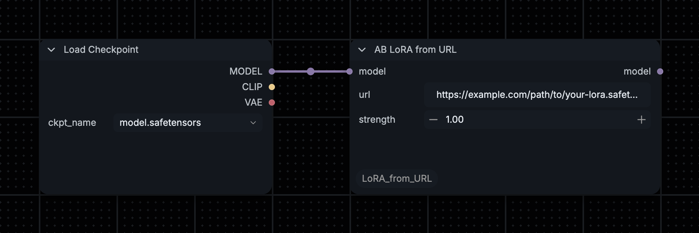

<div align="center">

# AB LoRA from URL: load a LoRA by its link in ComfyUI

**Paste a download link, get the LoRA applied to your model; no manual download into the loras folder.**

<br />

[](https://github.com/a-und-b/ComfyUI_LoRA_from_URL/stargazers)
&nbsp;
[](https://registry.comfy.org/nodes/lora_from_url)
&nbsp;
[](https://registry.comfy.org/nodes/lora_from_url)
&nbsp;
[](LICENSE)

<br />



---

Self-hosted LoRAs, LoRAs from a training run, LoRAs a colleague shares by link: each one usually means a download, a copy into `models/loras` and a refresh. AB LoRA from URL downloads the file on the first run, keeps it in a local cache and applies it to the model.

[Install](#install) · [Example workflow](#example-workflow) · [Usage](#usage) · [Contributing](#contributing)

</div>

---

## Why AB LoRA from URL

The core LoRA loader only sees files already in `models/loras`. This node takes a direct `.safetensors` link instead. The download is the node's only network call: http(s) only, with timeouts, written to a `.part` file and renamed when complete, so a broken download never lands in the cache. Dependencies: `requests`, `tqdm`.

## Features

| You want | You use |
|----------|---------|
| A LoRA from a direct download link | its URL in `url` |
| The LoRA weaker or stronger | `strength` (0–10) |
| No second download on the next run | the cache in `input/url_loras/` (one file per URL) |
| An error instead of a silent run without the LoRA | download or load errors stop the run on the node |

## Install

**ComfyUI Manager:** search for **AB LoRA from URL**, install, restart ComfyUI.

**comfy-cli:**

```bash
comfy node install lora_from_url
```

**Manually:**

```bash
cd ComfyUI/custom_nodes/
git clone https://github.com/a-und-b/ComfyUI_LoRA_from_URL.git
pip install -r ComfyUI_LoRA_from_URL/requirements.txt
```

Restart ComfyUI. The node appears under **AB/Loaders**; search for `AB LoRA` or `lora url`.

## Example workflow

[`ab-lora-from-url-load-lora-by-link.json`](example_workflows/ab-lora-from-url-load-lora-by-link.json): **Load Checkpoint** → **AB LoRA from URL**. Drag the file onto the canvas, or open it in ComfyUI under Workflow → Browse Templates, under the pack's name. Then:

1. Choose a local checkpoint in **Load Checkpoint**.
2. Replace the placeholder URL with a direct `.safetensors` link you host or trust.
3. Connect the `model` output to your sampler and queue.

## Usage

1. Connect a `MODEL` to `model`.
2. Paste the LoRA URL into `url` and set `strength`.
3. Use the `model` output like any model with a LoRA applied.

Only load files from sources you trust: a LoRA file is model weights, but you still decide what runs on your machine.

## Contributing

Bug reports and pull requests are welcome. Open an [issue](https://github.com/a-und-b/ComfyUI_LoRA_from_URL/issues) first for larger changes; [`CONTRIBUTING.md`](CONTRIBUTING.md) has the three steps.

## License

[MIT](LICENSE)

---

<div align="center">

Built by [Holger Will](https://github.com/a-und-b) at [anders & besser](https://andersundbesser.de)

<br />

[](https://github.com/a-und-b/ComfyUI_LoRA_from_URL/stargazers)

</div>
