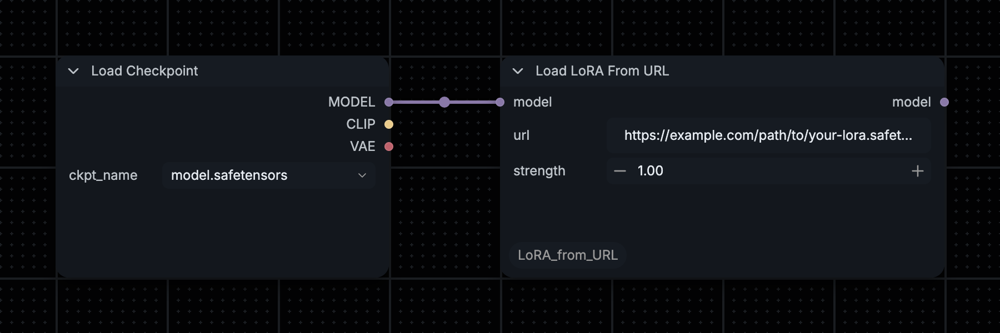

# ComfyUI Load LoRA From URL

A simple custom node for ComfyUI that downloads a LoRA from a public URL (cached under `input/url_loras/`) and applies it to a model. Intended for self-hosted LoRA files with direct download links.



## Features

- Download a `.safetensors` LoRA from a URL
- Local cache so repeated runs skip the download
- Configurable strength
- No Manager extras beyond the Python deps listed below

## Installation

### Via ComfyUI Manager

Search for `lora_from_url` / **ComfyUI_LoRA_from_URL** and install, then restart ComfyUI.

### Manual

```bash
cd ComfyUI/custom_nodes/
git clone https://github.com/a-und-b/ComfyUI_LoRA_from_URL.git
pip install -r ComfyUI_LoRA_from_URL/requirements.txt
```

Restart ComfyUI. The node appears under **loaders** as **Load LoRA From URL**.

## Example workflow

1. Load [`example_workflows/lora-from-url-example.json`](example_workflows/lora-from-url-example.json).
2. Point **CheckpointLoaderSimple** at a local checkpoint.
3. Replace the placeholder URL with a direct `.safetensors` download link you host or trust.
4. Queue the workflow.

Preview: [`example_workflows/lora-from-url-preview.png`](example_workflows/lora-from-url-preview.png).

## Usage

1. Connect a `MODEL` into **Load LoRA From URL**.
2. Paste the LoRA URL and set **strength**.
3. Use the output `MODEL` like any other LoRA-applied model.

## License

MIT — see [LICENSE](LICENSE).
